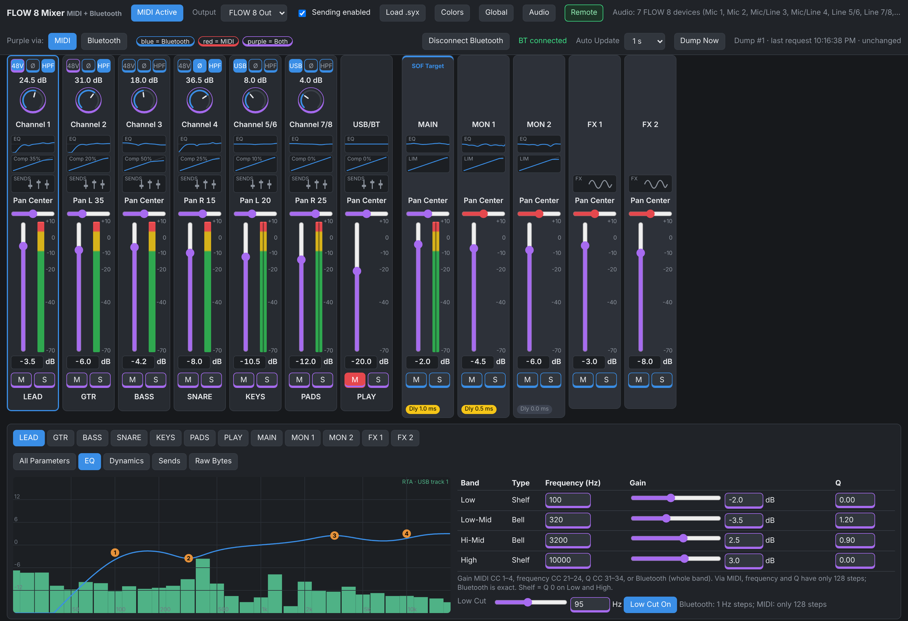
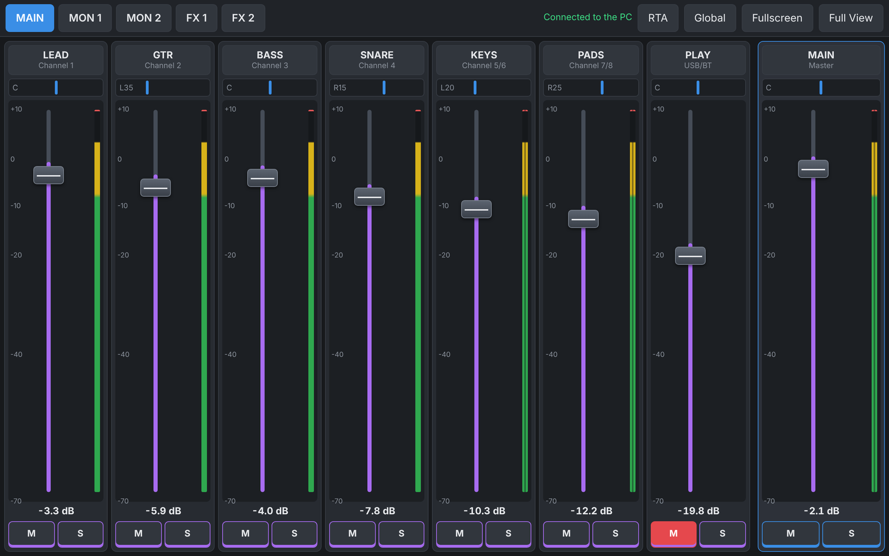
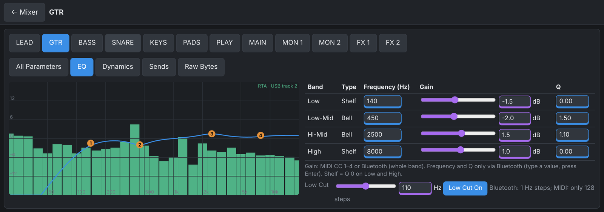

# FLOW 8 Web Remote

🇬🇧 **English version: [see below](#english).**

Inoffizielle Fernsteuerung für das **Behringer FLOW 8** im Browser: eine einzige HTML-Seite, ohne Installation, ohne Cloud, ohne Konto.

> **Du brauchst nur einen Chromium-Browser**, z. B. **Microsoft Edge** oder **Google Chrome**. Nichts installieren. Firefox und Safari gehen nicht (ihnen fehlen Web MIDI und Web Bluetooth).

> **100 % vibe coded mit Claude.** Privates Hobbyprojekt, komplett im Dialog mit Claude (Anthropic) entstanden und geteilt, falls es jemand nützlich findet. Kein Support, keine Garantie, Rückmeldungen willkommen. Nicht von Behringer / Music Tribe; „Behringer“ und „FLOW 8“ sind Marken ihrer Inhaber.

## So startest du

Du brauchst: das FLOW 8, ein USB-Kabel und einen PC mit Edge oder Chrome.

1. **Herunterladen:** Oben auf dieser Seite auf den grünen Knopf **Code** klicken, dann **Download ZIP**.
2. **Entpacken:** ZIP-Datei mit Rechtsklick → **Alle extrahieren** in einen eigenen Ordner auspacken.
3. **Anschließen:** FLOW 8 einschalten und per USB mit dem PC verbinden.
4. **Starten:**
   - **Windows:** `start-mixer.bat` doppelklicken. Edge öffnet sich mit der Seite. Warnt Windows, auf **Weitere Informationen** → **Trotzdem ausführen** klicken (die Datei ist lesbarer Klartext).
   - **Mac / Linux:** `flow8-mixer-ble.html` mit Chrome oder Edge öffnen (Rechtsklick → Öffnen mit). Hier fehlen nur die Audio-Anzeigen (Pegel und RTA).
5. **Erlauben:** Fragt der Browser nach MIDI-Zugriff, auf **Zulassen** klicken. Dann einmal irgendwo auf die Seite klicken, im Bluetooth-Fenster das **FLOW 8** wählen und **Koppeln**.
6. **Fertig:** Sobald der Mixerzustand angekommen ist, werden die Regler freigeschaltet.

Tipp: Das FLOW 8 nimmt per Bluetooth nur **ein** Gerät an. Vorher in der Handy-App Bluetooth trennen.

### Ohne Download: direkt im Browser

Die Seite läuft auch ohne Herunterladen: **[letsketchup.github.io/flow8-web-remote/flow8-mixer-ble.html](https://letsketchup.github.io/flow8-web-remote/flow8-mixer-ble.html)** in Edge oder Chrome öffnen, FLOW 8 per USB anschließen, dann weiter ab Schritt 5. Aus dem Internet kommt nur die Seite selbst; MIDI und Bluetooth laufen direkt zwischen deinem Rechner und dem FLOW 8.

Unterschiede zur heruntergeladenen Version:
- **Keine Tablet-/Handy-Fernsteuerung** (dafür braucht es `start-mixer.bat`).
- **Sprachen:** eingebaut ist Englisch; andere Sprachen über **Sprachdatei laden…** mit einer Datei aus dem Ordner `languages`.
- **Pegel und RTA:** online noch nicht getestet.
- Einstellungen (Farben, Sprache, RTA) speichert der Browser getrennt von der heruntergeladenen Version.

## Was es kann

- Kanalzüge, Busse und Main: Fader, Mute, Solo, Pan/Balance, Gain, Kompressor, Low Cut, Phase, EQ (Gain, Frequenz und Güte auch per MIDI), Sends, Delay, Limiter
- Effekte (FX 1 / FX 2) mit den Preset-Namen aus der FLOW-App, und Snapshots 1–15
- Steuerung per **MIDI (USB)** und **Bluetooth**; Farben zeigen, welcher Weg für welches Element gilt
- Pegelanzeigen und **Echtzeit-Analyzer (RTA)** über die USB-Audioverbindung (Windows). Gemessen dort, wo das FLOW 8 seine USB-Aufnahmespuren abgreift: Eingangskanäle direkt nach dem Gain ohne Low Cut und EQ, Main ohne Main-EQ
- Mehrere Sprachen, eigene Farben
- **Tablet-Oberfläche** (Windows-PC als Brücke): eigene Mischpult-Ansicht für Tablets im Querformat, ohne App, optional mit Zugangscode (siehe unten)

**Sicherheitsregeln:** Es wird nichts automatisch verstellt, die Seite sendet nur, was du bedienst. 48V nur von Hand mit Rückfrage. Reset, Werksreset und Snapshot speichern/löschen gibt es bewusst nicht.

## Sprachen

Auswahl unter **Global → Mixer Settings → Language** (auf Deutsch: Mixer-Einstellungen → Sprache). Standard ist Englisch, Deutsch ist dabei.

**Eigene Sprache erstellen:**

1. `languages/en.txt` kopieren und umbenennen, z. B. `fr.txt`.
2. Erste Zeile anpassen: `language:Français` (so erscheint sie in der Auswahl).
3. In jeder Zeile nur den Text **rechts** vom ersten Doppelpunkt übersetzen. Links nichts ändern, Platzhalter wie `{n}` stehen lassen.
4. Datei in den Ordner `languages/` legen und die Seite neu laden. Mit `start-mixer.bat` erscheint sie automatisch. Ohne .bat (z. B. Mac): **Language → Load Language File…** (Sprache → Sprachdatei laden…)
5. Fehlende Zeilen werden auf Englisch angezeigt, du kannst also auch Stück für Stück übersetzen.

Teilen: Datei gern als Pull Request oder Issue einreichen.

## Tablet-Oberfläche

Während die Seite über `start-mixer.bat` am PC läuft, öffnet jedes Tablet (ab 7", Querformat) oder Handy im selben WLAN eine eigene Mischpult-Ansicht im Browser, ohne App. Der PC bleibt mit dem FLOW 8 verbunden und führt alles aus; Zustand, Pegel und RTA kommen vom PC.

- **Mixer-Ansicht:** alle Kanäle und der Master ohne Scrollen, oben die Mixe MAIN, MON 1/2, FX 1/2 (bei MON und FX zeigen die Fader die Sends). Fader und Pan sind fein untersetzt und springen nicht: überall anfassen, nur die Bewegung zählt; mehrere Finger gleichzeitig gehen. Pan doppelt tippen = Mitte.
- **Kanal-Ansicht:** Kanalnamen antippen. EQ mit Low Cut und RTA, Dynamik (Gain mit Eingangsmeter, Kompressor, Phase, 48V), Sends; bei den Ausgängen Limiter und Delay.
- **Oben:** RTA-Einstellungen (immer gleich wie am PC), Global, Vollbild und die normale Vollansicht.

**Verbinden:**

1. PC und Tablet ins selbe WLAN.
2. `start-mixer.bat` starten. Fragt die Windows-Firewall, den Zugriff für **private Netzwerke** erlauben.
3. Am PC **Remote** öffnen und **Fernsteuerung erlauben** einschalten (ist anfangs aus).
4. Den angezeigten QR-Code mit der Kamera des Tablets scannen oder die Adresse eintippen (z. B. `http://192.168.1.20:8000/flow8-mixer-ble.html?code=…`).

**Zugangscode:** Ist die Fernsteuerung aus, kommt kein Gerät herein, und verbundene werden sofort getrennt. Standardmäßig verlangt der PC einen Code; er steckt in der angezeigten Adresse und wird pro Gerät nur einmal gebraucht. **Neuer Code** sperrt alle bisherigen Geräte aus. Ohne Code kann jedes Gerät im WLAN steuern. Die Einstellung wird gespeichert. **Snapshots** gehen bewusst nur am PC; 48V geht mit Rückfrage auch am Tablet.

## Bewusst simpel und im Klartext

- **Eine HTML-Datei**, kein Build-Schritt, keine Pakete, keine Abhängigkeiten. Alles (auch `start-mixer.bat`, der Server `flow8-server.ps1` und die Sprachdateien) ist lesbarer Klartext.
- **Kein Internet:** Die Seite lädt nichts aus dem Internet und sendet nichts nach außen. Der Mini-Server ist nur im eigenen WLAN erreichbar: Port 8000 für Tablets und Handys (mit Zugangscode, siehe oben). Der Server beendet sich selbst, wenn die Seite geschlossen wird.
- **Sprachdateien sind reiner Text**, sie werden nie als Code ausgeführt.
- Einstellungen liegen nur im Speicher deines Browsers.

## Mehr Infos

- **MIDI-Implementierung des FLOW 8 (Englisch), vollständig und geprüft:** [`docs/FLOW8-MIDI-Implementation.md`](docs/FLOW8-MIDI-Implementation.md), auch als Webseite: [letsketchup.github.io/flow8-web-remote](https://letsketchup.github.io/flow8-web-remote/)
- **Technisches Handbuch (Englisch):** [`docs/MANUAL.md`](docs/MANUAL.md) – MIDI, SysEx-Dump, Bluetooth, Tablet-Oberfläche, Kurven und Umrechnungen, Audio/RTA, Sprachdateien
- Bedienungsanleitung für Einsteiger (PDF, Englisch): [`FLOW8-Web-Remote-User-Manual.pdf`](FLOW8-Web-Remote-User-Manual.pdf)
- Für Entwickler: Protokoll-Tabelle [`docs/flow8-midi-sysex-ble-tabelle.csv`](docs/flow8-midi-sysex-ble-tabelle.csv), Fader- und Low-Cut-Tabellen in [`docs/`](docs/)

## Herkunft, Haftung, Lizenz

- Das Bluetooth-Protokoll und Teile der MIDI-Zuordnung beruhen auf [abelroes/flow-8-midi](https://github.com/abelroes/flow-8-midi) (nur Protokollfakten, kein Quelltext). Danke!
- Nutzung **auf eigene Gefahr**, ohne Gewähr. Falsche Pegel können Lautsprecher und Gehör gefährden, Phantomspeisung empfindliche Mikrofone.
- Lizenz: [GPL-3.0](LICENSE). Nutzen, ändern und weitergeben erlaubt; weitergegebene Änderungen ebenfalls unter GPL mit Quelltext.

---

# English

Unofficial browser remote control for the **Behringer FLOW 8**: a single HTML page, no installation, no cloud, no account.

> **All you need is a Chromium-based browser**, e.g. **Microsoft Edge** or **Google Chrome**. Nothing to install. Firefox and Safari do not work (they lack Web MIDI and Web Bluetooth).

> **100% vibe coded with Claude.** A private hobby project, built entirely in conversation with Claude (Anthropic) and shared in case someone finds it useful. No support, no warranty, feedback welcome. Not affiliated with Behringer / Music Tribe; "Behringer" and "FLOW 8" are trademarks of their respective owners.

## Getting started

You need: the FLOW 8, a USB cable and a computer with Edge or Chrome.

1. **Download:** click the green **Code** button at the top of this page, then **Download ZIP**.
2. **Unzip:** right-click the ZIP file → **Extract All** into a folder of its own.
3. **Connect:** switch on the FLOW 8 and connect it to the computer via USB.
4. **Start:**
   - **Windows:** double-click `start-mixer.bat`. Edge opens with the page. If Windows shows a warning, click **More info** → **Run anyway** (the file is readable plain text).
   - **Mac / Linux:** open `flow8-mixer-ble.html` with Chrome or Edge (right-click → Open With). Only the audio displays (meters and RTA) are missing here.
5. **Allow:** when the browser asks for MIDI access, click **Allow**. Then click anywhere on the page once, pick the **FLOW 8** in the Bluetooth window and click **Pair**.
6. **Done:** as soon as the mixer state has arrived, the controls are unlocked.

Tip: the FLOW 8 accepts only **one** Bluetooth device. Disconnect Bluetooth in the phone app first.

### Without download: straight in the browser

The page also runs without downloading anything: open **[letsketchup.github.io/flow8-web-remote/flow8-mixer-ble.html](https://letsketchup.github.io/flow8-web-remote/flow8-mixer-ble.html)** in Edge or Chrome, connect the FLOW 8 via USB, then continue with step 5. Only the page itself comes from the internet; MIDI and Bluetooth run directly between your computer and the FLOW 8.

Differences to the downloaded version:
- **No tablet/phone remote** (that needs `start-mixer.bat`).
- **Languages:** English is built in; other languages via **Load Language File…** with a file from the `languages` folder.
- **Level meters and RTA:** not tested online yet.
- The browser stores settings (colors, language, RTA) separately from the downloaded version.

## Features

- Channel strips, buses and main: faders, mute, solo, pan/balance, gain, compressor, low cut, phase, EQ (gain, frequency and Q also over MIDI), sends, delay, limiter
- Effects (FX 1 / FX 2) with the preset names from the FLOW app, and snapshots 1–15
- Control via **MIDI (USB)** and **Bluetooth**; colors show which route each control uses
- Level meters and **real-time analyzer (RTA)** over the USB audio connection (Windows). Measured where the FLOW 8 taps its USB recording tracks: input channels right after the gain without low cut and EQ, main without the main EQ
- Several languages, custom colors
- **Tablet interface** (Windows computer as the bridge): a mixing-desk view for tablets in landscape, no app, optional access code (see below)

**Safety rules:** nothing is changed automatically; the page only sends what you operate. 48V only by hand, with confirmation. Reset, factory reset and saving/deleting snapshots are deliberately left out.

## Languages

Select under **Global → Mixer Settings → Language**. English is the default, German is included.

**Create your own language:**

1. Copy `languages/en.txt` and rename it, e.g. `fr.txt`.
2. Change the first line: `language:Français` (this is how it appears in the list).
3. In each line, translate only the text **to the right** of the first colon. Do not change anything on the left; keep placeholders such as `{n}`.
4. Put the file into the `languages/` folder and reload the page. With `start-mixer.bat` it appears automatically. Without the .bat (e.g. on a Mac): **Language → Load Language File…**
5. Missing lines are shown in English, so you can translate bit by bit.

Sharing: feel free to submit your file as a pull request or issue.

## Tablet interface

While the page runs on the computer via `start-mixer.bat`, any tablet (7" and up, landscape) or phone in the same network opens a mixing-desk view in its browser, no app needed. The computer stays connected to the FLOW 8 and carries everything out; state, levels and RTA come from the computer.

- **Mixer view:** all channels and the master without scrolling, mixes MAIN, MON 1/2, FX 1/2 at the top (for MON and FX the faders show the sends). Faders and pan are finely geared and never jump: touch anywhere, only the movement counts; several fingers at once work. Double-tap pan = center.
- **Channel view:** tap a channel name. EQ with low cut and RTA, Dynamics (gain with input meter, compressor, phase, 48V), Sends; for the outputs limiter and delay.
- **At the top:** RTA settings (always the same as on the computer), Global, Fullscreen and the normal Full View.

**Connecting:**

1. Put the computer and the tablet in the same network.
2. Start `start-mixer.bat`. If the Windows firewall asks, allow access for **private networks**.
3. On the computer, open **Remote** and switch on **Allow remote control** (off at first).
4. Scan the QR code shown there with the tablet's camera, or type the address (e.g. `http://192.168.1.20:8000/flow8-mixer-ble.html?code=…`).

**Access code:** with remote control switched off, no device gets in and connected ones are cut off at once. By default the computer requires a code; it is part of the address shown and is needed only once per device. **New Code** locks out all devices that used the old one. Without a code, any device in the network can control the mixer. The setting is remembered. **Snapshots** deliberately work only on the computer; 48V works on the tablet too, with a confirmation.

## Deliberately simple and plain text

- **One HTML file**, no build step, no packages, no dependencies. Everything (including `start-mixer.bat`, the server `flow8-server.ps1` and the language files) is readable plain text.
- **No internet:** the page loads nothing from the internet and sends nothing outside. The mini server is reachable only in your own network: port 8000 for phones and tablets (with access code, see above). The server shuts itself down when the page is closed.
- **Language files are plain text**; they are never executed as code.
- Settings are stored only in your browser.

## More information

- **Behringer FLOW 8 MIDI implementation chart, complete and tested:** [`docs/FLOW8-MIDI-Implementation.md`](docs/FLOW8-MIDI-Implementation.md), also as a web page: [letsketchup.github.io/flow8-web-remote](https://letsketchup.github.io/flow8-web-remote/)
- **Technical manual:** [`docs/MANUAL.md`](docs/MANUAL.md) – MIDI, SysEx dump, Bluetooth, tablet interface, curves and conversions, audio/RTA, language files
- Beginner's user manual (PDF): [`FLOW8-Web-Remote-User-Manual.pdf`](FLOW8-Web-Remote-User-Manual.pdf)
- For developers: protocol table [`docs/flow8-midi-sysex-ble-tabelle.csv`](docs/flow8-midi-sysex-ble-tabelle.csv), fader and low-cut tables in [`docs/`](docs/) (protocol and fader tables have German column headers)

## Origin, disclaimer, license

- The Bluetooth protocol and parts of the MIDI mapping are based on [abelroes/flow-8-midi](https://github.com/abelroes/flow-8-midi) (protocol facts only, no source code). Thank you!
- Use **at your own risk**, without warranty. Wrong levels can endanger speakers and hearing; phantom power can damage sensitive microphones.
- License: [GPL-3.0](LICENSE). You may use, modify and redistribute it; distributed modifications must also be GPL with source code.
