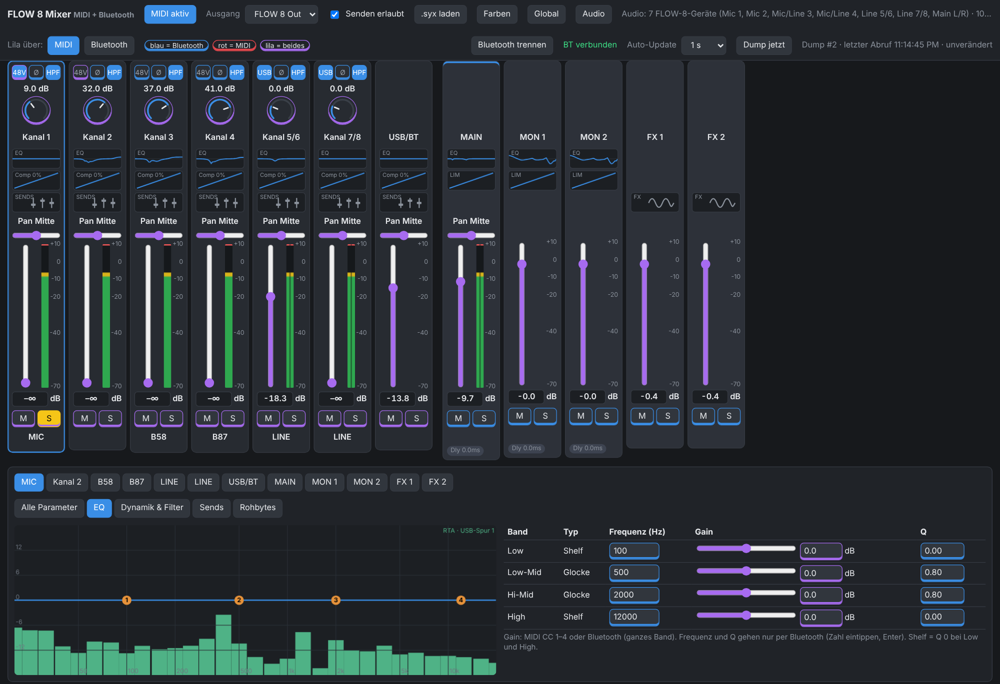

# FLOW 8 Web Remote

🇬🇧 **English version: [jump to the English section below](#english).**

*Screenshot mit Beispieldaten, die Oberfläche ist deutsch. / Screenshot with sample data, the interface is in German.*

Inoffizielle Fernsteuerung für das **Behringer FLOW 8** im Browser: eine einzige HTML-Seite, ohne Installation, ohne Cloud, ohne Konto.

> **Nicht von Behringer / Music Tribe.** „Behringer“ und „FLOW 8“ sind Marken ihrer Inhaber. Dieses Projekt ist unabhängig und nicht mit ihnen verbunden.

> **100 % vibe coded mit Claude.** Das Projekt ist ein privates Hobbyprojekt, komplett im Dialog mit Claude (Anthropic) entstanden. Ich teile es, falls es jemand anderes nützlich findet. Es gibt keinen Support und keine Garantie, Rückmeldungen und Verbesserungen sind aber willkommen.

## Was es kann

- Kanalzüge, Busse und Main mit Fadern, Mute, Solo, Pan, Gain, Kompressor, Low Cut, Phase und 4-Band-EQ
- Effekte (FX 1 / FX 2) und Snapshots 1–15
- Steuerung per **MIDI (USB)** und/oder **Bluetooth (BLE)** – die Oberfläche zeigt farbig, welcher Weg für welches Element gilt
- **Echtzeit-Analyzer (RTA)** über die USB-Audioverbindung: 1/3 Oktave, 1/12 Oktave und Fein, mit Tilt, Automatic Gain Control und einstellbarer Deckkraft
- Eigene Farben, Global-Fenster, Audio-Fenster
- Deutsche Bedienungsanleitung für Einsteiger: [`FLOW8-Mixer-Bedienungsanleitung.pdf`](FLOW8-Mixer-Bedienungsanleitung.pdf), englische Fassung: [`FLOW8-Web-Remote-User-Manual.pdf`](FLOW8-Web-Remote-User-Manual.pdf)

## Sicherheitsregeln (bewusst eingebaut)

- Es wird **nichts automatisch verstellt**. Die Seite liest Werte aus und sendet nur, was du selbst bedienst.
- **48V Phantomspeisung** lässt sich nur von Hand schalten, mit Bestätigungsdialog.
- **Snapshot 16 (Reset)**, **Werksreset** sowie Snapshot speichern/löschen gibt es nicht.

## Voraussetzungen

| | |
|---|---|
| Browser | **Microsoft Edge** oder **Google Chrome** (Web MIDI und Web Bluetooth gibt es in Firefox und Safari nicht) |
| Verbindung | USB-Kabel zum FLOW 8 (MIDI) und/oder Bluetooth |
| Windows | `start-mixer.bat` verwenden (empfohlen, siehe unten) |
| macOS / Linux | HTML-Datei direkt öffnen, ohne RTA (siehe unten) |

## Schnellstart

### Windows (volle Funktion inkl. RTA)

1. Alle Dateien in einen **eigenen, leeren Ordner** legen (der Mini-Server liefert alle Dateien aus diesem Ordner aus).
2. `start-mixer.bat` doppelklicken. Es startet ein kleiner lokaler Server, der **nur auf deinem PC** (`localhost:8000`) erreichbar ist, und öffnet die Seite in Edge. Er beendet sich selbst, sobald du die Seite schließt.
3. Im Browser **MIDI aktivieren** (SysEx-Freigabe erlauben) und/oder **Bluetooth verbinden**.

Hinweis: Windows SmartScreen oder dein Virenscanner können bei heruntergeladenen `.bat`-Dateien warnen. Die Datei ist Klartext; du kannst sie vor dem Start in einem Editor lesen.

### macOS / Linux (ohne .bat)

`flow8-mixer-ble.html` per Doppelklick in Chrome oder Edge öffnen. MIDI und Bluetooth funktionieren. Die Audio-Funktionen (RTA) brauchen eine Adresse mit `localhost` und fehlen deshalb in dieser einfachen Variante.

## Bluetooth und MIDI gleichzeitig

Das FLOW 8 nimmt per Bluetooth **nur ein Gerät** an. Es geht aber, mit dem Handy per Bluetooth und mit dem PC per MIDI-USB gleichzeitig zu steuern.

## Dateien

| Datei | Zweck |
|---|---|
| `flow8-mixer-ble.html` | die eigentliche Anwendung |
| `start-mixer.bat` | optionaler Windows-Starter mit lokalem Mini-Server |
| `FLOW8-Mixer-Bedienungsanleitung.pdf` | Bedienungsanleitung (Deutsch, 11 Seiten) |
| `FLOW8-Web-Remote-User-Manual.pdf` | User manual (Englisch, 12 Seiten; die Bedienoberfläche und die Screenshots bleiben deutsch) |
| `images/screenshot.png` | Screenshot für diese README |
| `images/social-preview.png` | Vorschaubild für GitHub (1280×640), in den Repo-Einstellungen hochladen |

## Sicherheit und Datenschutz: bewusst simpel

- **Offener Quelltext:** Die Anwendung ist eine einzige HTML-Datei mit eingebettetem CSS und JavaScript. Es gibt keinen Build-Schritt, keinen Minifier, keine Pakete und keine Abhängigkeiten.
- **Alles im Klartext:** Du kannst jede Datei in einem normalen Texteditor öffnen und lesen, auch die `start-mixer.bat`. Es ist nichts verschleiert oder binär.
- **Alles lokal:** Die Seite lädt nichts aus dem Internet (keine externen Skripte, Schriften oder Tracker) und sendet keine Daten nach außen. Die einzigen Netzwerkaufrufe gehen an den eigenen PC (`localhost`). Du kannst es prüfen, indem du den Quelltext nach `http` durchsuchst.
- **Lesbar und wartbar:** Der Code ist kommentiert und in einer Datei überschaubar. Wer eine Änderung will, bearbeitet die Datei direkt oder lässt sich dabei von einer KI helfen.
- **Mini-Server nur für deinen PC:** Der optionale Server der `.bat` hört nur auf `localhost:8000`, ist aus dem Netzwerk nicht erreichbar und beendet sich selbst.
- **Gespeichert wird nur Lokales:** Einstellungen (Modus, Farben, Audio-Optionen, zuletzt gewähltes MIDI-Gerät) liegen im `localStorage` deines Browsers.

## Stand und Grenzen

- Nicht jede Wertebedeutung in den Einstellungen ist an echter Hardware geprüft. Bei Abweichungen bitte als Issue melden.
- `start-mixer.bat` und der Betrieb unter macOS/Linux sind noch wenig getestet.
- Mehrere angeschlossene FLOW 8 gleichzeitig sind ungeprüft.

## Herkunft des Protokolls

Das Bluetooth-Protokoll (Dienst, Merkmal, statischer Schlüssel, Prüfsumme) und Teile der MIDI-Zuordnung beruhen auf dem Mitschnitt und der Dokumentation von [abelroes/flow-8-midi](https://github.com/abelroes/flow-8-midi). Es wurden nur Protokollfakten übernommen, kein Quelltext. Vielen Dank an das Projekt.

## Haftungsausschluss

Nutzung **auf eigene Gefahr**. Die Software wird „wie besehen“ ohne Gewähr bereitgestellt. Falsche Einstellungen können Lautsprecher oder Gehör gefährden, Phantomspeisung kann empfindliche Mikrofone beschädigen. Kontrolliere Pegel und angeschlossene Geräte, bevor du etwas einschaltest.

## Lizenz

[GNU General Public License v3.0](LICENSE) (GPL-3.0). Du darfst die Software nutzen, ändern und weitergeben. Geänderte Versionen, die du weitergibst, müssen ebenfalls unter der GPL und mit Quelltext stehen.

---

# English

## FLOW 8 Web Remote

Unofficial browser remote control for the **Behringer FLOW 8**: a single HTML page, no installation, no cloud, no account.

> **Not affiliated with Behringer / Music Tribe.** "Behringer" and "FLOW 8" are trademarks of their respective owners. This project is independent and not connected to them.

> **100% vibe coded with Claude.** This is a private hobby project, built entirely in conversation with Claude (Anthropic). I am sharing it in case someone else finds it useful. There is no support and no warranty, but feedback and improvements are welcome.

> **Note:** the user interface itself and the screenshots in the manual are in German. The English manual explains every button with its English meaning.

### Features

- Channel strips, buses and main with faders, mute, solo, pan, gain, compressor, low cut, phase and 4-band EQ
- Effects (FX 1 / FX 2) and snapshots 1–15
- Control over **MIDI (USB)** and/or **Bluetooth (BLE)**; the interface shows by color which route each control uses
- **Real-time analyzer (RTA)** over the USB audio connection: 1/3 octave, 1/12 octave and fine, with tilt, Automatic Gain Control and adjustable opacity
- Custom colors, Global window, Audio window
- User manual for beginners: [`FLOW8-Web-Remote-User-Manual.pdf`](FLOW8-Web-Remote-User-Manual.pdf) (German version: [`FLOW8-Mixer-Bedienungsanleitung.pdf`](FLOW8-Mixer-Bedienungsanleitung.pdf))

### Built-in safety rules

- **Nothing is changed automatically.** The page reads values and only sends what you operate yourself.
- **48V phantom power** can only be switched by hand, with a confirmation dialog.
- **Snapshot 16 (reset)**, **factory reset** and saving/deleting snapshots do not exist.

### Requirements

| | |
|---|---|
| Browser | **Microsoft Edge** or **Google Chrome** (Web MIDI and Web Bluetooth are not available in Firefox and Safari) |
| Connection | USB cable to the FLOW 8 (MIDI) and/or Bluetooth |
| Windows | use `start-mixer.bat` (recommended, see below) |
| macOS / Linux | open the HTML file directly, without RTA (see below) |

### Quick start

**Windows (full functionality including RTA)**

1. Put all files in their **own, empty folder** (the mini server serves all files in this folder).
2. Double-click `start-mixer.bat`. It starts a small local server that is reachable **only on your PC** (`localhost:8000`) and opens the page in Edge. It shuts itself down when you close the page.
3. In the browser, click **MIDI aktivieren** (Enable MIDI; allow the SysEx permission) and/or **Bluetooth verbinden** (Connect Bluetooth).

Note: Windows SmartScreen or your virus scanner may warn about downloaded `.bat` files. The file is plain text; you can read it in an editor before running it.

**macOS / Linux (without .bat)**

Open `flow8-mixer-ble.html` in Chrome or Edge by double-click. MIDI and Bluetooth work. The audio functions (RTA) need an address with `localhost` and are therefore missing in this simple variant.

### Bluetooth and MIDI at the same time

The FLOW 8 accepts **only one device** over Bluetooth. You can, however, control it with your phone over Bluetooth and with the PC over MIDI/USB at the same time.

### Files

| File | Purpose |
|---|---|
| `flow8-mixer-ble.html` | the actual application |
| `start-mixer.bat` | optional Windows launcher with a local mini server |
| `FLOW8-Web-Remote-User-Manual.pdf` | user manual (English, 12 pages; the interface and screenshots remain German) |
| `FLOW8-Mixer-Bedienungsanleitung.pdf` | user manual (German, 11 pages) |
| `images/screenshot.png` | screenshot used in this README |
| `images/social-preview.png` | preview image for GitHub (1280×640), upload in the repository settings |

### Security and privacy: deliberately simple

- **Open source code:** the application is a single HTML file with embedded CSS and JavaScript. There is no build step, no minifier, no packages and no dependencies.
- **Everything in plain text:** you can open every file in an ordinary text editor and read it, including `start-mixer.bat`. Nothing is obfuscated or binary.
- **Everything local:** the page loads nothing from the internet (no external scripts, fonts or trackers) and sends no data outside. The only network calls go to your own PC (`localhost`). You can verify this by searching the source for `http`.
- **Readable and maintainable:** the code is commented and manageable in one file. If you want a change, edit the file directly or get help from an AI.
- **Mini server for your PC only:** the optional server of the `.bat` listens only on `localhost:8000`, is not reachable from the network and shuts itself down.
- **Only local storage:** settings (mode, colors, audio options, last selected MIDI device) are kept in your browser's `localStorage`.

### Status and limitations

- Not every meaning of the settings has been verified on real hardware. Please report deviations as an issue.
- `start-mixer.bat` and operation on macOS/Linux have had little testing.
- Several FLOW 8 units connected at the same time are untested.

### Origin of the protocol

The Bluetooth protocol (service, characteristic, static key, checksum) and parts of the MIDI mapping are based on the capture and documentation of [abelroes/flow-8-midi](https://github.com/abelroes/flow-8-midi). Only protocol facts were taken, no source code. Many thanks to that project.

### Disclaimer

Use **at your own risk**. The software is provided "as is" without warranty. Wrong settings can endanger speakers or hearing, and phantom power can damage sensitive microphones. Check levels and connected devices before you switch anything on.

### License

[GNU General Public License v3.0](LICENSE) (GPL-3.0). You may use, modify and redistribute the software. Modified versions that you distribute must also be licensed under the GPL and come with source code.
